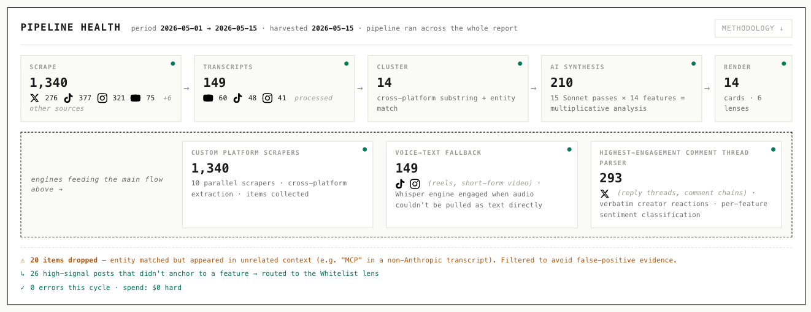

# TrendingAI

A clone-and-run editorial intelligence pipeline for AI-creator content. Twelve harvesters run in parallel — **X, TikTok, Instagram, YouTube + AI podcasts, Reddit, Hacker News, GitHub, arXiv, Bluesky, editorial feeds, frontier-lab announcements, enterprise channels** — pulling thousands of items in five minutes. Deterministic TypeScript clusters them into named features. Then the magic: every confirmed feature gets **verbatim creator sentiment synthesized inline inside your Claude Code session**. Every cited tweet, TikTok, IG reel, and YouTube clip renders as a real embed. One self-contained HTML you can hand to anyone.

**~21,000 lines of TypeScript across 85 source files · 6 synthesis prompts · 238 passing tests · 12 data sources · one Claude Code skill · one slash command: `/trendingai`.**



The included `out/features-confirmed.html` is the reference baseline from our internal UAT — open it in any browser to see exactly what your run will produce.

---

## What you actually get

Type `/trendingai` in a Claude Code session opened in this bundle. Twenty minutes later, `out/features-confirmed-runNNN-{date}.html` is on disk and in your browser:

- **Features & Flags** — every named lab feature creators talked about this cycle, ranked across three tiers. A sentiment-by-feature heat-grid up top shows how the creator chorus reacted to each: landing hot, landing cold. Per-card: verbatim reactions, PRAISED / COMPLAINED summary synthesized inline, RATIOED callouts when engagement and sentiment disagree (a 35k-engagement post with 80% negative replies gets flagged).
- **Hot in Podcasts** — we transcribe **hundreds of hours of AI podcasts** every cycle and cluster what podcasters keep returning to: model-quality vibes, governance shifts, AI doom narratives cracking. Themes, not product launches.
- **Industry News** — substantive AI-industry events (legal cases, policy moves, exec departures, fundraising, security incidents) cross-referenced against verbatim transcript citations from the shows that covered them.
- **Security** — exploits, supply-chain attacks, model-welfare reports, capability + policy moves. Severity tags and named action items: what you'd patch tonight if you'd seen it.
- **GitHub** — top AI repos this window with editorial verdicts (`TRICK` / `VERIFY` / `REAL` / `PRE-VIRAL` / `HYPE`) and per-repo cross-platform signal indicators.
- **One to Watch** — the prediction-modelling anchor. Six streams (arxiv, frontier-lab releases, X, TikTok, Instagram, GitHub) ranked by cross-source corroboration. Bets on what surfaces in next cycle's Features & Flags before it does.
- Plus Op-Ed, Multimedia, and Whitelist lenses.

Every claim cites real URLs from the harvest. Every visible element is either deterministic from on-disk data or honestly surfaced as AI-marked. Re-render against the same harvest yields byte-identical HTML.

---

## Install (~2 minutes)

Requires macOS, [Claude Code](https://claude.ai/code) signed in on a **Pro or Max plan**, [Bun](https://bun.sh/), `yt-dlp`, `ffmpeg`.

```bash
git clone <repo-url>
cd <repo>
bun install
bun test                       # 238 tests should pass
bun run features:render-only   # renders the included baseline (~30s, $0)
```

Test suite green + a fresh HTML in `out/` = you're ready.

---

## Credentials

This is the **public** version of TrendingAI. Internally we run custom scrapers we built ourselves. For the public bundle we've also sourced sensible Apify + Groq alternatives, so you can run the pipeline end-to-end without writing your own harvest layer.

*Curious how the custom scrapers work? Find us at [glitchcatclub.com](https://glitchcatclub.com) or on our YouTube livestreams.*

The skill prompts you for two free-tier signup tokens on first run and writes them to a local `.env` — nothing pastes into source files.

| Token | Covers | Where |
|---|---|---|
| `APIFY_TOKEN` | X / TikTok / Instagram / YouTube + reply threads + transcription | [console.apify.com](https://console.apify.com/account/integrations) — free tier ~$5 credit, no card. Covers ~15-25 fresh runs. |
| `GROQ_API_KEY` | Whisper Large v3 Turbo for Instagram reel audio transcription | [console.groq.com](https://console.groq.com) — free tier covers our cadence indefinitely. |

No Anthropic API key required. See **Anthropic authentication** below for why.

---

## Run the report

```bash
claude
```

Then in the Claude Code prompt:

```
/trendingai
```

The skill narrates the pipeline stage by stage: twelve scrapers fire in parallel, Whisper transcribes Instagram reels in the background, deterministic TypeScript clusters thousands of items into named features, six Opus synthesis passes happen inline inside the same Claude Code conversation — one window, no subagents, no subprocess forks. The renderer writes a single self-contained HTML and opens it in your browser.

The skill asks **fresh-harvest** vs **render-only** every time:

| Path | Wall-clock | Hard cost |
|---|---|---|
| Fresh harvest (all 12 sources) | ~15-20 min | ~$0.15 – $0.30 |
| Render-only (cached bundle data) | ~30 sec | $0 |

Each run produces a new numbered file (`run001`, `run002`, …). Previous runs stay on disk. `out/latest.html` symlinks to the most recent.

---

## Cost + wall-clock

Hard cost per fresh run:

| Stage | Cost |
|---|---|
| Data harvest + reply threads + transcription | ~$0.10 – $0.20 |
| Groq Whisper audio transcription | ~$0.05 |
| Anthropic Opus synthesis | **$0 marginal** — subscription-billed via Claude Pro/Max OAuth |
| **Total** | **~$0.15 – $0.30** |

Time per fresh run:

| Stage | Time |
|---|---|
| Harvest (12 sources, parallel) | 5 – 8 min |
| Deterministic extraction | 10 – 15 sec |
| Synthesis (6 inline Opus passes) | 8 – 12 min |
| Deterministic post-processing | 5 – 30 sec |
| Render | 2 sec |
| **Total** | **< 25 min** |

Render-only: under 60 seconds at $0.

Tuned for efficient daily/weekly cadence — cheap enough to run as a morning cron job. More data means more accuracy; the bundle is configured for steady efficient cycles rather than burst harvests. The Apify free tier covers ~15-25 runs; the Groq free tier covers our cadence indefinitely.

---

## Anthropic authentication

This bundle does **not** read `ANTHROPIC_API_KEY`, call `claude --print` subprocess, or use the Agent SDK.

Anthropic's June-15 billing change ended subscription-billed `--print` and now charges programmatically for any API-key call. So we removed every programmatic reference and routed synthesis to run **inline inside your Claude Code session** — the conversation itself, orchestrated by **Opus 4.7**, is the model. Synthesis stages execute as turns of that conversation. Your Pro/Max plan covers it; marginal cost is $0.

The bundle's defensive code explicitly deletes `ANTHROPIC_API_KEY` from the environment before each synthesis call to prevent accidental programmatic billing.

---

## What's in the bundle

```
TrendingAI/
├── README.md                ← this file
├── CLAUDE.md                ← project-level Claude Code rules
├── .env.example             ← env var template
├── .gitignore               ← excludes .env, data/raw/, node_modules
├── package.json             ← bun scripts
├── tsconfig.json
├── bun.lock
│
├── .claude/skills/TrendingAI/
│   ├── SKILL.md             ← skill descriptor + trigger phrases
│   └── Workflows/
│       ├── Run.md           ← full pipeline (fresh-harvest path)
│       └── RenderOnly.md    ← cached-data fast path
│
├── prompts/                 ← 6 synthesis prompts (593 lines)
│   ├── feature-sentiment.md
│   ├── cross-narratives.md
│   ├── industry-news.md
│   ├── industry-news-merger.md
│   ├── creator-recs.md
│   └── podcast-themes.md
│
├── src/                     ← 46 production TypeScript files
│   ├── harvesters/          ← 12 data-source harvesters + orchestrator
│   ├── features-first.ts    ← cross-platform entity extraction + clustering
│   ├── feature-sentiment.ts ← per-feature synthesis driver
│   ├── render-features-first.ts  ← THE renderer (frozen by design)
│   └── …
│
├── scripts/                 ← 16 deterministic helper scripts
├── data/                    ← cached JSON snapshots for render-only smoke test
├── fixtures/                ← test fixtures
├── benchmark/               ← perf benchmark known-good set
├── docs/                    ← README assets (pipeline.png)
│
└── out/
    ├── features-confirmed.html            ← reference baseline (immutable)
    ├── features-confirmed-run009-*.html   ← internal UAT final
    └── latest.html                        ← symlink → most recent run
```

---

## Tests

```bash
bun test
```

238 tests across 23 files, 731 expect() calls. Covers dedupe + canonical URL contracts, clustering math, sentiment classifier shape, renderer anti-XSS escapes, deterministic ID derivation, and adversarial-injection falsifiers.

---

## Troubleshooting

| Symptom | Fix |
|---|---|
| `claude: command not found` | Install Claude Code from https://claude.ai/code |
| `bun: command not found` | `curl -fsSL https://bun.sh/install \| bash`, restart shell |
| `yt-dlp` / `ffmpeg` missing | `brew install yt-dlp ffmpeg` |
| Harvest fails with `401` / `402` | `APIFY_TOKEN` unset, typo'd, or out of credit — check `.env` and your Apify dashboard |
| `GROQ_API_KEY missing` | Check `.env`, sign up at console.groq.com |
| Tests fail | You modified something — re-clone to restore the green baseline |
| Rendered HTML empty | Substrate too thin this cycle (rare) — re-run fresh harvest |
| `out/latest.html` symlink broken | Run any generation to recreate |

For anything else, open Claude Code in the bundle and ask. The skill workflows document every recovery branch in `.claude/skills/TrendingAI/Workflows/Run.md`.

---

## Known limitations + roadmap (v1)

Synthesis runs on **Opus 4.7**. Polish items carried from internal UAT — none break the pipeline or the editorial content:

1. **Pipeline-stats header counter** — the "AI synthesis" counter in the report header can show `0` even though synthesis ran successfully. Cosmetic only.
2. **Notable-this-period panel placement** — currently between Tier 1 and Tier 2 cards; will move below Tier 3.
3. **Industry News substrate-surface viz** — uniform circular layout regardless of signal weight; will vary by signal next release.
4. **Tier 1 lab-prestige boost** — features from frontier labs may land Tier 2 by the current formula when editorially they belong Tier 1; tuning fix coming.

**Coming in the next release:**

- **Trained prediction-modelling algorithm** — One to Watch currently ranks by deterministic cross-source corroboration. Once 3-4 cycles of historical snapshots accumulate, a trained classifier projects which surfaced signals are most likely to land as features in subsequent cycles. The `MOCK` accuracy chips in the One to Watch lens light up once enough labelled data accrues.
- **Cross-cycle velocity** — once historical snapshots accumulate, per-feature trending velocity (`rising` / `stable` / `fading`) surfaces as a badge.

---

## Platform

Mac-only for v1. Linux/Windows portability is structurally possible (Bun + yt-dlp + ffmpeg are cross-platform) but unverified for v1.

---

## License + credits

Built as a hackathon submission, 2026-05-27, by **[Glitch Cat Club](https://glitchcatclub.com)**. **Attribution required** — if you fork or build on this, please credit Glitch Cat Club and link back.
